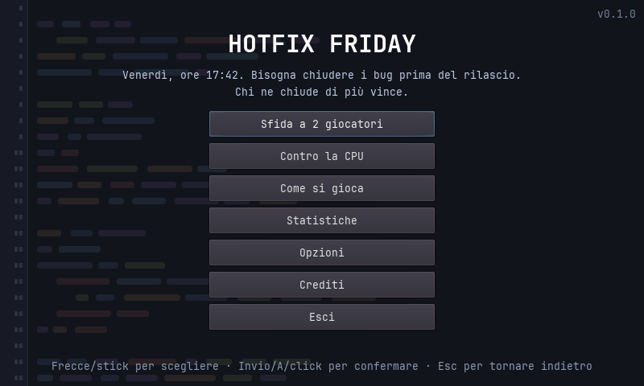
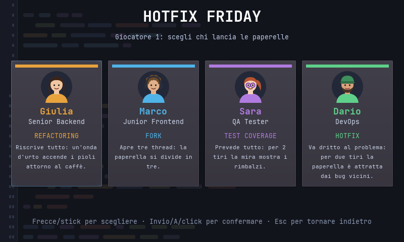
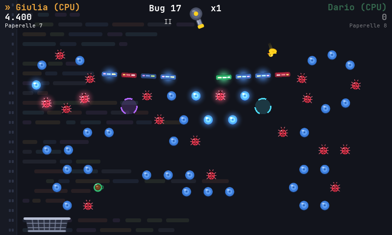

# Hotfix Friday

Venerdì pomeriggio, ufficio di programmatori: bisogna chiudere i bug prima del rilascio.
Gioco 2D originale del genere "peg shooter": si lanciano paperelle di gomma su un campo di righe di codice per eliminare i bug.
Ogni personaggio ha un potere che si attiva colpendo una tazza di caffè.
Open source, pensato per Linux desktop e per **Raspberry Pi 3** (versione portatile).

> **Versione 0.1.1.** Gioco completo per Linux e Raspberry Pi; prestazioni sul Pi 3 ancora da verificare.
> Novità in [CHANGELOG.md](CHANGELOG.md), piano di sviluppo in [ROADMAP.md](ROADMAP.md).

| | | |
|---|---|---|
|  |  |  |

## Scaricare e giocare

Dalla pagina [Releases](../../releases) scarica l'archivio per il tuo sistema:

| Archivio | Per |
|---|---|
| `hotfix-friday-linux-x86_64.tar.gz` | PC Linux a 64 bit |
| `hotfix-friday-rpi-arm64.tar.gz` | Raspberry Pi con sistema a 64 bit |
| `hotfix-friday-rpi-arm32.tar.gz` | Raspberry Pi con sistema a 32 bit |

```bash
tar -xzf hotfix-friday-linux-x86_64.tar.gz
cd hotfix-friday-linux-x86_64
./hotfix-friday.x86_64        # gioca subito
./install.sh                 # oppure aggiungilo al menu delle applicazioni
```

## Requisiti

- [Godot 3.6.3](https://godotengine.org/download/3.x/) (non Godot 4: il Pi 3 supporta solo OpenGL ES 2.0)
- Export template di Godot 3.6.3 (servono solo per creare le build)

## Dal sorgente

```bash
godot3 --path . --editor --quit   # solo la prima volta dopo il clone: importa gli asset
godot3 --path .             # Linux, dal sorgente
tools/export.sh arm64       # build per Raspberry Pi (anche: x86_64, arm32, oppure tutte senza argomenti)
```

Sfida a turni, a due giocatori sullo stesso dispositivo o contro la CPU: si tira una paperella a testa sullo stesso campo,
i punti vanno a chi tira e vince chi ne ha di più quando i bug (pioli rossi) sono finiti. Ogni campo è generato da codice.
Si mira con mouse, touch, frecce o stick e si lancia rilasciando il click/dito, oppure con spazio o A.

Guide:
- [docs/comandi.md](docs/comandi.md): tutti i comandi per giocare su Linux e Raspberry Pi, dal sorgente o dalla build, opzioni e controlli
- [docs/raspberry-pi.md](docs/raspberry-pi.md): preparazione del Pi e benchmark
- [docs/poteri.md](docs/poteri.md): personaggi, poteri e come aggiungerne di nuovi
- [docs/domande-aperte.md](docs/domande-aperte.md): decisioni di design ancora da confermare

## Struttura

```
scenes/    scene Godot (.tscn)
scripts/   script GDScript
levels/    campi fissi in JSON (opzionali, formato in scripts/game/level_loader.gd)
assets/    grafica (SVG), suoni, musica e font
data/      dati di gioco (personaggi)
locale/    traduzioni italiano/inglese (translations.csv)
tools/     build, installazione, test, benchmark e generazione di sfondo e suoni
docs/      documentazione
```

## Contribuire

Nuovi poteri, personaggi, lingue e figure dei campi sono pensati per essere aggiunti facilmente:
vedi [CONTRIBUTING.md](CONTRIBUTING.md).

## Licenza

Codice sotto licenza [MIT](LICENSE). Asset e attribuzioni in [ASSETS.md](ASSETS.md).
